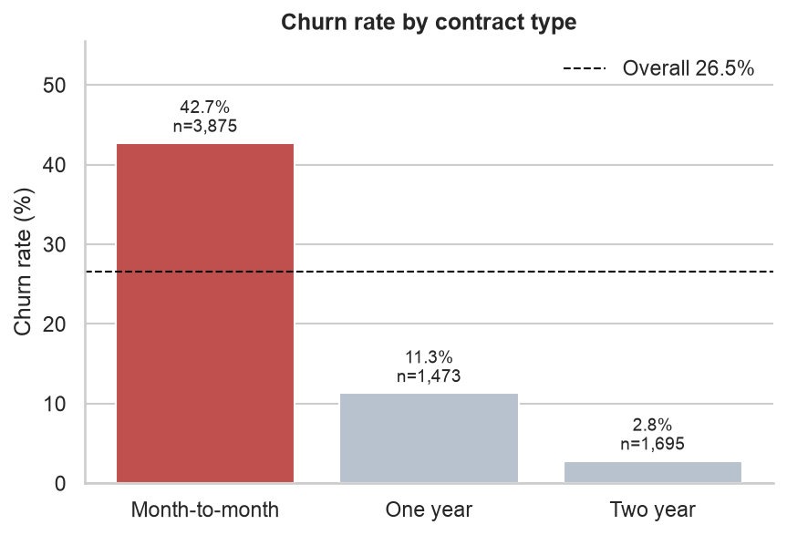
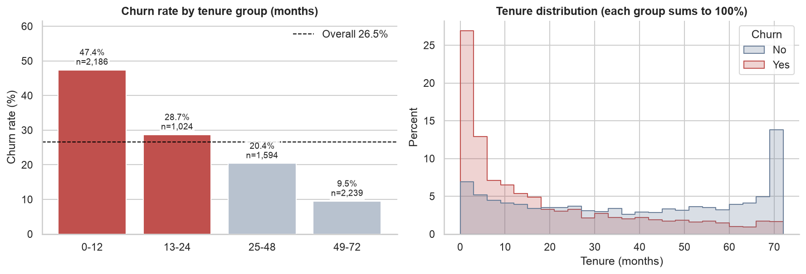
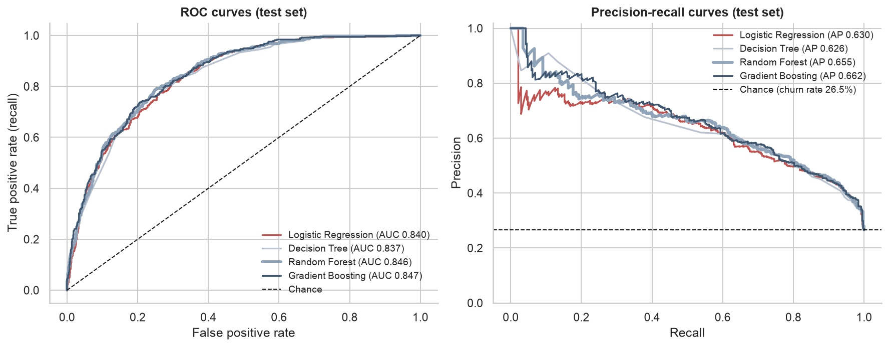
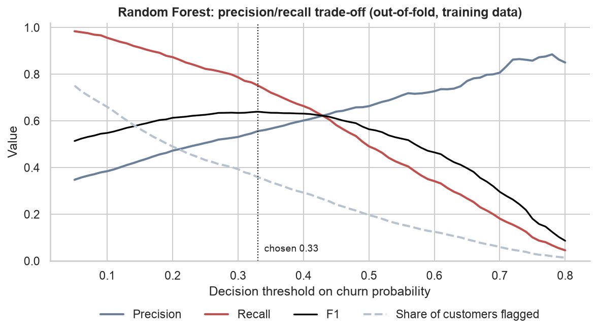
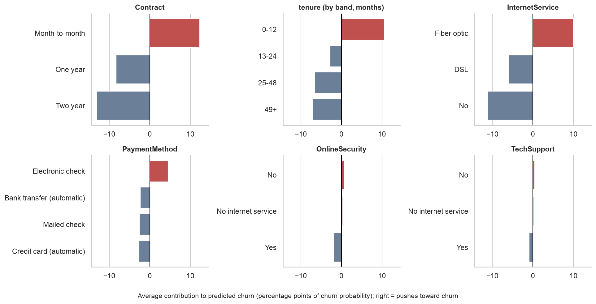
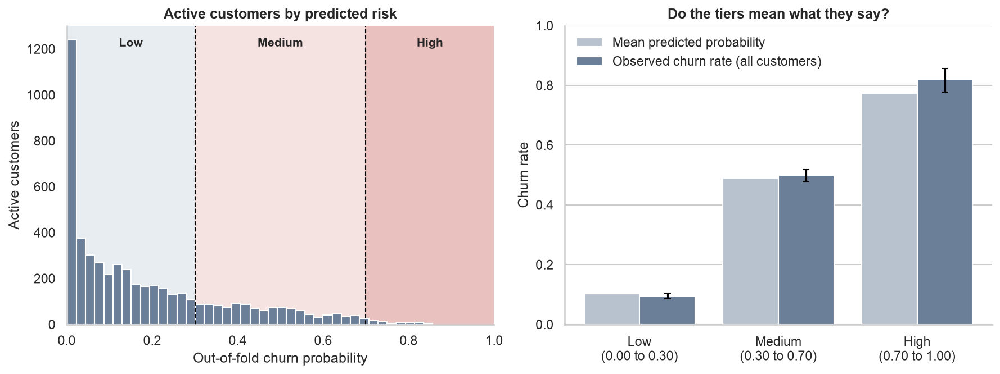

# Customer Churn Prediction & Retention Analytics

An end-to-end data science project: from a raw telecom customer file to cleaned data, exploratory analysis, a tested feature pipeline, four compared models, per-customer churn probabilities with explanations, risk segments, SQL analysis, and a complete Power BI dashboard specification.

```
DATA  ->  UNDERSTANDING  ->  PREDICTION  ->  RISK  ->  BUSINESS ACTION
```

**Status at a glance**

| Part | State |
|---|---|
| Data cleaning, EDA notebook, feature selection, models, explanations, predictions, SQL | Done, executed, and covered by automated tests |
| Power BI data model, Power Query, 27 DAX measures, four-page specification, expected values | Done as a specification. **The `.pbix` file is not included**: Power BI Desktop is a Windows application and could not be run here. See [`powerbi/BUILD_GUIDE.md`](powerbi/BUILD_GUIDE.md) |
| Dashboard screenshots in this README | Placeholders until the dashboard is built |

Everything below is computed from the data by the code in this repository. Where something is an assumption, it says so.

---

## Overview

Using the public Telco Customer Churn sample data (7,043 customers), the project answers one practical question: **which customers are likely to leave, how much revenue is exposed, and what should a retention team test first?** Along the way it deliberately avoids the common traps: leaking test data, trusting accuracy on an imbalanced target, reading correlations as causes, and quoting numbers that were not actually computed.

## Business Problem

A subscription business loses customers continuously. Retention offers cost money, so a team needs to know *who* to contact, *how urgently*, and *what is at stake*, without wasting offers on customers who would have stayed. This project turns a customer table into a ranked, explained, revenue-weighted list, and into a dashboard design that a retention manager can use.

## Objectives

| # | Question | Answer (all figures are computed in this repository) |
|---|---|---|
| 1 | How many customers are churning? | 1,869 of 7,043 customers (26.5%) |
| 2 | What factors are associated with churn? | Contract type, tenure and internet service carry nearly all of the model's reliance (permutation importance 0.087, 0.064 and 0.057 AUC); payment method is next at 0.004 |
| 3 | Which types of customers are most likely to churn? | Month-to-month contracts (42.7% churn), customers in their first year (47.4%), fiber optic (41.9%), electronic-check payers (45.3%) |
| 4 | Which individual customers are at high risk? | `output/customer_churn_predictions.csv`: among the 5,174 active customers, 65 are High risk and 1,168 are Medium risk |
| 5 | How much revenue is exposed? | Churned customers hold 30.5% of monthly charges. For active customers, probability-weighted monthly revenue at risk is 69,018.94 (21.8% of active charges); the High-risk tier alone is 5,317.85 |
| 6 | What could the company do? | Prioritised, testable hypotheses by risk and value segment (see Business Recommendations) |

## Dataset

- **Source:** the Telco Customer Churn sample file, downloaded from the IBM GitHub repository `IBM/telco-customer-churn-on-icp4d` (`data/Telco-Customer-Churn.csv`).
- **Licence, as far as verified:** that repository is licensed Apache 2.0. The dataset's own original provenance statement was **not** found in the repository text that was checked, and its terms were not independently confirmed. The file is widely redistributed as an IBM sample dataset, but that is general knowledge, not something verified here. Treat the repository licence as covering the repository, and check the data's terms before any commercial use.
- **Integrity:** `python -m src.download_data` downloads the file and verifies its SHA-256 (`16320c9c1ec72448db59aa0a26a0b95401046bef5d02fd3aeb906448e3055e91`), so every number here corresponds to this exact file. The raw CSV is git-ignored for the licence reason above.
- **Shape:** 7,043 rows, 21 columns, one row per customer, unique `customerID`.
- **Target:** `Churn` (Yes/No). 1,869 Yes (26.54%), 5,174 No (73.46%). A model that always says "No" would be right 73.5% of the time, so accuracy alone is not a valid yardstick.
- **Numeric:** `tenure`, `MonthlyCharges`, `TotalCharges`. **Categorical:** 15 columns (demographics, phone and internet services, contract, billing, payment method), plus `SeniorCitizen` stored as 0/1.
- **Leakage review:** no explicit post-churn column (no churn reason or date). One structural caveat: this is a **single snapshot with no dates**. For churners, tenure and total charges are measured up to the moment they left, so a model learns *who looks like a churner*, not a true forecast over a time horizon.

## Technologies Used

Python 3.12 (tested), pandas, NumPy, scikit-learn, SciPy, Matplotlib, Seaborn, SHAP, joblib, SQL (SQLite), Jupyter, pytest, Power Query (M), DAX, Power BI Desktop (specification). Exact versions: [`requirements.txt`](requirements.txt), checked by a test against what the code imports.

## Project Architecture

```
data/raw  --download_data-->  preprocessing  -->  data/processed/churn_clean.csv
                                                        |
        notebooks/churn_analysis.ipynb  <---------------+-----> feature_engineering (+ feature_ablation)
                                                        |
                                                 train_model  -->  models/churn_model.pkl
                                                        |
                          interpretation  <-------------+------------->  predict (out-of-fold scoring)
                                                                              |
                                                       output/customer_churn_predictions.csv
                                                              |                       |
                                                        sql/ + run_sql          powerbi/ (model, DAX, spec)
```

Design rules that run through every stage:

- **Nothing is decided by looking at the test set.** Tuning, model selection and the decision threshold all use cross-validation on the training split. The test set is scored once, afterwards, for every model.
- **Fixed seed (42) everywhere**, relative paths only, and a single `src/config.py` for paths and constants.
- **Every claim a report makes is computed by code**, and tests check that generated files, quoted numbers and references stay in sync.

## Data Cleaning

Implemented in [`src/preprocessing.py`](src/preprocessing.py); every decision is logged with what, why and effect in [`data/processed/cleaning_log.md`](data/processed/cleaning_log.md).

- **`TotalCharges` stored as text with hidden blanks.** `isna()` reports 0 missing values, but 11 cells are whitespace. All 11 rows have `tenure = 0` (customers not yet billed) and `Churn = No`, so they were set to 0 rather than mean-imputed, which would invent revenue. The code stops with an error if any blank row has `tenure > 0`. This is an interpretation of the pattern, not something the dataset states.
- No duplicate rows, no other missing values, no invalid or non-positive charges, no IQR outliers, and no contradictions between the phone/internet service columns.
- 22 validation checks run on the cleaned file, and a test compares the cleaned file with the raw file to confirm nothing else changed.

## Exploratory Data Analysis

[`notebooks/churn_analysis.ipynb`](notebooks/churn_analysis.ipynb) (executed, with every chart answering one stated question, written as observation, interpretation, business implication). All findings are **associations in one snapshot, not causes**.




- **Contract:** 42.7% churn on month-to-month, 11.3% on one year, 2.8% on two years. Month-to-month customers are 55.0% of the base but 88.6% of churners.
- **Tenure:** 47.4% in the first 12 months, falling to 9.5% beyond 48 months. 55.5% of churners left within their first year. The tenure effect persists *within* month-to-month contracts (51.4% down to 26.0%), so it is not just the contract effect.
- **Internet service:** fiber 41.9%, DSL 19.0%, no internet 7.4%. Fiber is not just a price effect: inside the shared 65-95 price band, fiber churns at 48.8% against 7.1% for DSL.
- **Protective add-ons** (security, backup, device protection, tech support): among internet customers, churn falls from 56.7% with none to 5.3% with all four. The model later shows much of this overlaps with contract and tenure.
- **Payment method:** electronic check 45.3% against 15.2% to 19.1% for the others, and the gap holds inside month-to-month contracts.
- **No signal:** gender (26.9% vs 26.2%) and phone service.

## Feature Engineering

Implemented in [`src/feature_engineering.py`](src/feature_engineering.py) as a scikit-learn pipeline that takes the cleaned table and returns predictions. Row-wise features cannot leak between rows, and everything that learns from data (scaling, encoding) is fitted on training rows only. Tests prove that: the scaler's mean equals the *training* mean, and a deliberately leaky preprocessor is detected.

The EDA suggested three features (`TenureGroup`, `ProtectiveAddOnCount`, `AutoPay`). Rather than assume they help, [`src/feature_ablation.py`](src/feature_ablation.py) tested them with repeated cross-validation on the training split ([`output/feature_ablation.md`](output/feature_ablation.md)). Findings:

- **The engineered features added no measurable accuracy** (every change was 0.0008 AUC or smaller, inside the noise), so the final feature set does not include them. They remain available in code for descriptive use.
- **`TotalCharges` is dropped** because it is essentially tenure x monthly charge (variance inflation factor 9.51).
- **`MonthlyCharges` is dropped** because the services a customer holds already explain 99.88% of it (R-squared 0.9988): the bill is a price list. With both present, logistic-regression coefficients for the services were unstable and implausible; removing it cost no accuracy in logistic regression, random forest or gradient boosting.
- **`gender` is dropped:** no association with churn and no accuracy cost, and one fewer protected attribute in a retention model. The other four low-signal columns are kept, because removing them as a group lowered AUC slightly.
- **Consequence:** this dataset cannot separate price from services, so no price-sensitivity claim is made.

The final model input has 23 columns. Details and the full ablation table are in section 11 of the notebook.

## Machine Learning

[`src/train_model.py`](src/train_model.py) tunes four models with 5-fold stratified cross-validation on the training split (5,634 rows; the other 1,409 are held out): Logistic Regression, Decision Tree, Random Forest and Gradient Boosting, scored by ROC-AUC.

**Class imbalance (26.5% churn).** Rather than re-weighting, the models use no class weights. Re-weighting does not change how well customers are ranked, it only moves the cutoff, and it distorts the probabilities that the dashboard depends on. Evidence from out-of-fold training predictions:

| Model | Weights | ROC-AUC | Customers flagged at 0.5 | Brier score | Mean predicted probability (true rate 0.265) |
|---|---|---|---|---|---|
| Random Forest | none | 0.8469 | 19.6% | 0.1347 | 0.265 |
| Random Forest | balanced | 0.8464 | 40.7% | 0.1607 | 0.404 |
| Logistic Regression | none | 0.8446 | 21.7% | 0.1354 | 0.266 |
| Logistic Regression | balanced | 0.8444 | 40.4% | 0.1650 | 0.415 |

**Model selection.** The rule was fixed before running: among models within one standard error of the best cross-validated AUC, choose the simplest. Gradient Boosting scored highest (0.8504), but Random Forest (0.8482) falls within one standard error, so Random Forest was selected. Be aware this is a close call between three statistically similar models: Logistic Regression (0.8451) missed the cutoff (0.8452) by 0.0001, and an earlier feature set had selected it instead.

## Model Evaluation

Test set (1,409 customers, scored once), threshold 0.5 for every model. [`output/model_report.md`](output/model_report.md) is generated by the run and also has bootstrap intervals, paired comparisons, confusion matrices and calibration.

| Model | Accuracy | Precision | Recall | F1 | ROC-AUC |
|---|---|---|---|---|---|
| Logistic Regression | 0.7977 | 0.6386 | 0.5481 | 0.5899 | 0.8396 |
| Decision Tree | 0.7899 | 0.6204 | 0.5374 | 0.5759 | 0.8373 |
| **Random Forest (final)** | 0.8006 | 0.6609 | 0.5107 | 0.5762 | **0.8462** (95% CI 0.825 to 0.867) |
| Gradient Boosting | 0.8020 | 0.6621 | 0.5187 | 0.5817 | 0.8468 |

The confidence intervals overlap heavily: differences of a few thousandths between models are not distinguishable on a test set with 374 churners.



**Precision vs recall, and the operating threshold.** A missed churner loses the customer's revenue; a false alarm wastes one offer. So recall matters, but how much depends on costs the dataset does not contain. The threshold **0.33** maximises F1 on out-of-fold *training* predictions (a convention that needs no cost assumption, not a business-optimal value). On the test set:

| Threshold | Precision | Recall | F1 | Churners caught | False alarms |
|---|---|---|---|---|---|
| 0.50 | 0.661 | 0.511 | 0.576 | 191 of 374 | 98 |
| **0.33** | 0.543 | 0.738 | 0.626 | 276 of 374 | 232 |

Contacting a customer pays off when `p x s x V > c` (churn probability, success chance of an offer, value of a retained customer, cost of the offer), so the break-even threshold is `c / (s x V)`. A company supplies that ratio; the threshold table in the report shows what each cutoff implies for workload.



**Calibration.** The mean predicted probability on the test set is 0.267 against an observed 0.265, and the deciles track the diagonal, so the probabilities can be read as probabilities.

## Model Interpretation

[`src/interpretation.py`](src/interpretation.py), with output in [`output/model_interpretation.md`](output/model_interpretation.md). Three views: permutation importance, exact tree SHAP values per customer (in percentage points of probability), and a companion logistic regression with bootstrap odds ratios as a transparent second opinion (18 of 19 direction comparisons agree; the one miss, `Partner`, is about zero in both).



Average effect on a customer's predicted churn probability: month-to-month +12.3 points, two-year -13.1; fiber +10.0, DSL -6.0; tenure 0-12 months +10.6, 49+ months -7.1; electronic check +4.5. In the companion model, holding everything else fixed: fiber vs DSL odds ratio 2.45 (2.06 to 2.96), a two-year contract 0.27 (0.18 to 0.36), +12 months of tenure 0.68 (0.64 to 0.72). Two results differ from the one-variable EDA and are worth reading carefully: the protective add-ons matter much less once contract, tenure and internet type are accounted for (OnlineSecurity odds ratio 0.68, TechSupport 0.72), and streaming services flip to a small positive association.

## Churn Prediction

[`src/predict.py`](src/predict.py) scores every customer with **out-of-fold** predictions: each of the 7,043 customers is scored (and explained) by a model fitted on the other four folds, so no one is scored by a model that saw them. Quality over all customers: ROC-AUC 0.8455, PR-AUC 0.6525, Brier 0.1356. A test confirms that out-of-fold scores are clearly below in-sample scores, so the label is a fact, not a claim.

The output [`output/customer_churn_predictions.csv`](output/customer_churn_predictions.csv) has 41 columns per customer, including `CustomerID`, `Churn`, `ChurnProbability`, `RiskCategory`, value segment, retention segment, revenue fields and the top drivers; every column is documented in [`output/predictions_data_dictionary.md`](output/predictions_data_dictionary.md). New customers can be scored with the saved model: `python -m src.predict --input new_customers.csv`.

## Risk Segmentation

Tiers: **Low** (probability below 0.30), **Medium** (0.30 to 0.70), **High** (above 0.70). These are practical project assumptions. They were kept because they pass a check fixed in advance: each tier's observed churn rate must fall inside its band. It does (all customers):

| Tier | Customers | Mean predicted | Observed churn rate (95% interval) |
|---|---|---|---|
| Low | 4,353 | 10.3% | 9.5% (8.6% to 10.4%) |
| Medium | 2,328 | 48.9% | 49.8% (47.8% to 51.9%) |
| High | 362 | 77.3% | 82.0% (77.8% to 85.7%) |



**Important reading for active customers.** Of the 362 High-tier customers, 297 have already churned, so only **65 of the 5,174 active customers are High risk** (15 of them high value). Risk counts and revenue at risk use active customers only, because churned customers cannot be retained:

| Tier (active) | Customers | Monthly charges | Expected monthly revenue at risk |
|---|---|---|---|
| High | 65 | 5,317.85 | 4,034.09 |
| Medium | 1,168 | 86,084.80 | 40,490.17 |
| Low | 3,941 | 225,583.10 | 24,494.68 |

Because the data is a snapshot with no time horizon, a probability means "of customers like this one, this share have left". It is a propensity, not a forecast, and "expected revenue at risk" is a propensity-weighted figure. "High value" means monthly charges in the top quartile (89.85 or more); revenue is monthly charges only, with no margin, lifetime value or stated currency.

## SQL

[`sql/churn_analysis.sql`](sql/churn_analysis.sql) has 16 documented queries (CTEs, window functions, conditional aggregation, `NTILE` gains tables, rank-based prioritisation). They run on SQLite with `python -m src.run_sql`, and the real outputs are in [`output/sql_results.md`](output/sql_results.md). **Every query is tested against an independent pandas calculation**, and the tests were mutation-checked (injected bugs such as integer division and a missing `Active` filter are caught). Example: the top risk decile holds 28.4% of all churners (lift 2.83), the top four deciles hold 80.0%, and the bottom three hold 2.8%.

## Power BI Dashboard

**Status: specified, not built.** [`powerbi/`](powerbi/) contains the star-schema data model (one fact table, 8 dimensions, 8 many-to-one relationships), Power Query for all 10 queries, 27 documented DAX measures, a four-page specification (plus a hidden drill-through page) with exact positions for every visual, wireframes, a theme, and [`powerbi/expected_values.md`](powerbi/expected_values.md), the numbers your dashboard should show. Follow [`powerbi/BUILD_GUIDE.md`](powerbi/BUILD_GUIDE.md) to build it in about two to three hours.

What is verified without Power BI: the schema has no orphaned keys, every column and measure referenced anywhere exists, no visual overlaps another, and the measure values agree with the SQL results. What is not: that the M and DAX text parses in Power BI Desktop, and how the visuals look.

| Page | Purpose |
|---|---|
| 1. Executive Overview | Seven KPI cards, churn by contract and tenure, active customers by risk tier |
| 2. Churn Drivers | Six driver charts (contract, tenure, internet, payment, charge band, add-ons) with demographic slicers |
| 3. Customer Risk | Risk distribution, at-risk customers by contract and tenure, probability histogram, a customer table with conditional formatting and drill-through |
| 4. Retention Strategy | Risk x value matrix, exposure by segment, main drivers, segment actions, top-10 priority list |

Screenshots (placeholders until you build the dashboard; the wireframes are in `powerbi/wireframes/`):


## Key Insights

All are associations in a single snapshot.

| Finding | Evidence | Business implication |
|---|---|---|
| Churn costs more revenue than headcount suggests | 26.5% of customers churned (1,869 of 7,043) but they hold 30.5% of monthly charges (139,131 of 456,117), because churners pay more on average | Measure exposure in revenue, not only in customers |
| Contract type is the strongest separator | Churn 42.7% / 11.3% / 2.8% by contract; month-to-month is 55.0% of customers but 88.6% of churners; Contract has the highest permutation importance (0.087 AUC) | Month-to-month customers are the main retention pool; test incentives to move to longer terms |
| Risk concentrates early in the lifecycle | 47.4% churn in the first 12 months; 55.5% of churners left in year one; +12 months of tenure has odds ratio 0.68 (0.64 to 0.72) holding other features fixed | Test onboarding and early-life interventions |
| Fiber customers churn far more, and price does not explain it | 41.9% vs 19.0% for DSL; inside the 65-95 price band 48.8% vs 7.1%; odds ratio 2.45 (2.06 to 2.96) | Investigate the fiber experience and competition (the data has no outage, ticket or competitor information) |
| Protective services go with lower churn, but less than raw rates suggest | 56.7% churn with no protective add-ons vs 5.3% with all four; in the model OnlineSecurity is 0.68 (0.58 to 0.81) and TechSupport 0.72 (0.59 to 0.88), an average effect of about 1 point or less | Bundling support is a hypothesis for a controlled test, not a proven lever |
| Electronic-check payers churn most | 45.3% vs 15.2% to 19.1% for other methods, and 53.7% vs 31.6% to 34.1% inside month-to-month | Test autopay nudges; the method may only be a marker for other differences |
| The model ranks customers well and its probabilities are honest | Random Forest test ROC-AUC 0.8462 (0.825 to 0.867), PR-AUC 0.6547; top decile holds 28.4% of churners; mean predicted 0.267 vs observed 0.265 | Use the scores to prioritise outreach |
| Operating point is a business choice | At threshold 0.33: recall 0.738, precision 0.543 (276 of 374 churners caught, 232 false alarms) | Cheap, broad offers favour a low threshold; costly offers favour a higher one; the company must supply cost and success rates |
| Among active customers, High risk is small and most exposure is in the middle | 65 High, 1,168 Medium, 3,941 Low; expected revenue at risk 69,018.94, of which Medium carries 40,490.17; "Low risk + standard value" (13,228.34) outranks both High segments on exposure | A small high-touch list plus scalable programmes for the Medium tier |
| Gender carries no signal | 26.9% vs 26.2% churn | Do not segment retention by gender |

## Business Recommendations

These are data-informed **hypotheses requiring validation**, not guaranteed solutions. Each should be piloted on a sample with a control group before wide rollout.

| Segment (active customers) | Size | Hypothesis to test |
|---|---|---|
| High risk + high value | 15 | Personal outreach by an account manager to understand needs, then a tailored offer |
| High risk + standard value | 50 | Low-cost automated save offer and an early-life check-in (active High-risk customers average 3.1 months of tenure, 2.3 in this segment) |
| Medium risk + high value | 363 | An incentive to move from month-to-month to a longer contract |
| Medium risk + standard value | 805 | Contract-upgrade or autopay nudges through low-cost channels; test bundling security or support services |
| Low risk + high value | 813 | Loyalty benefits and recognition; avoid discounts that may not be needed |
| Low risk + standard value | 3,128 | Maintain service quality; no retention spend indicated |

## Project Structure

```
customer-churn-prediction-powerbi/
├── data/
│   ├── raw/                       # downloaded by src/download_data.py (git-ignored)
│   └── processed/                 # churn_clean.csv, cleaning_log.md
├── notebooks/
│   └── churn_analysis.ipynb       # EDA and feature selection (executed)
├── src/
│   ├── config.py                  # paths and constants
│   ├── download_data.py           # checksum-verified download
│   ├── preprocessing.py           # logged, validated cleaning
│   ├── feature_engineering.py     # leakage-safe pipeline and split
│   ├── feature_ablation.py        # does each feature earn its place?
│   ├── train_model.py             # tuning, selection, test evaluation
│   ├── evaluation.py              # metrics, thresholds, calibration, plots
│   ├── interpretation.py          # SHAP, permutation importance, odds ratios
│   ├── predict.py                 # out-of-fold scoring and segmentation
│   ├── run_sql.py                 # runs sql/churn_analysis.sql on SQLite
│   ├── reporting.py               # shared Markdown table helper
│   └── powerbi_model.py, powerbi_pages.py, powerbi_docs.py   # Power BI design as code
├── models/                        # churn_model.pkl, model_metadata.json
├── output/                        # customer_churn_predictions.csv and generated reports
├── sql/
│   └── churn_analysis.sql
├── powerbi/                       # BUILD_GUIDE.md, power_query.m, dax_measures.dax, spec, wireframes, theme
├── images/                        # Power BI screenshot placeholders; eda/ and model/ charts
├── tests/                         # pytest suite
├── requirements.txt
├── pytest.ini
└── README.md
```

## How to Run

Requires Python 3.11 or newer (tested on 3.12). From the project root:

```bash
python -m venv .venv
source .venv/bin/activate              # Windows: .venv\Scripts\activate
pip install -r requirements.txt

python -m src.download_data            # fetch and verify the raw CSV
python -m src.preprocessing            # clean -> data/processed/churn_clean.csv
python -m src.feature_ablation         # feature experiments (a few minutes)
jupyter nbconvert --to notebook --execute --inplace notebooks/churn_analysis.ipynb   # optional: re-run the EDA notebook
python -m src.train_model              # tune, select, evaluate, save the model (a few minutes)
python -m src.interpretation           # explanations
python -m src.predict                  # out-of-fold scores -> output/customer_churn_predictions.csv
python -m src.run_sql                  # SQL results -> output/sql_results.md
python -m src.powerbi_docs             # regenerate the Power BI specification files
python -m pytest                       # run the tests
```

Run from the project root so the `src` package is importable. The notebook reads `output/feature_ablation.csv`, so run the ablation before executing it.

## Testing

`python -m pytest` runs the whole suite. It covers the cleaning (nothing but the intended cells change), the leakage controls (scaler fitted on training rows only, a leaky pipeline is detected), the evaluation helpers on hand-checkable cases, the out-of-fold property, every SQL query against pandas, the Power BI design (schema integrity, references, layout, agreement with SQL), the requirements file against the real imports, and the numbers quoted in this README against the generated reports. Several suites were mutation-checked: a deliberately injected bug is shown to make them fail.

**Reproducibility check.** At the time of packaging, every command in "How to Run" was executed from a clean copy of the repository with all generated files deleted. The regenerated cleaned data, predictions, reports, SQL results and Power BI files were byte-identical to the committed ones (21 files compared), the saved model gave identical probabilities for all 7,043 customers, the notebook's tables and text matched, and the full test suite passed.

## Limitations and Future Improvements

- **Snapshot data, no dates.** No trend, no time-to-churn, and probabilities are propensities, not forecasts. With timestamped data, a survival or discrete-time model would give genuine time-bound risk.
- **No cost or value data.** The operating threshold, "high value" and the recommendations cannot be optimised without offer costs, success rates, margin and lifetime value.
- **One dataset, one split.** The test set has 374 churners, so model differences of a few thousandths are noise. Repeated or nested cross-validation would tighten this.
- **Small hyperparameter search** (grids or 15 random candidates), to keep the run reproducible on one CPU. An exploratory wider search on an earlier feature set did not change the selection; it was not repeated for the final feature set.
- **Dashboard not built.** The next step is to build it from `powerbi/BUILD_GUIDE.md`, check it against the expected values, and replace the placeholder screenshots.
- **Model file.** `models/churn_model.pkl` is a pickle: load it only from a source you trust, with scikit-learn 1.8.x and the `src` package importable. The saved model is fitted on the 80% training split; refitting on all data would be a small improvement for scoring new customers.
- **Fairness.** Age-related features (`SeniorCitizen`) carry signal; using them to decide who receives offers is a deliberate policy choice, not a default.

## Disclaimer / Dataset Source

This is a learning and portfolio project built on a public sample dataset. It makes no claims about any real company, and its figures describe this file only. The dataset comes from the IBM repository named above (Apache 2.0 for the repository; the dataset's own terms were not independently confirmed). No licence has been chosen yet for this repository's own code; add one before publishing.
